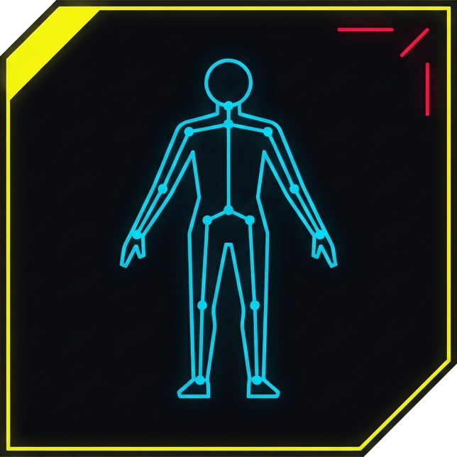

# Rig Items

Turn Unique V framework body rigs into Equipment-EX items, so you can install several at once and swap between them in-game without restarting.

Normally every framework rig replaces the same file, so only one can be installed and trying another means a trip through your mod manager and a relaunch. Rig Items gives each rig its own folder and its own item in the **Left Toes** slot. Equip one to wear that body; unequip it to go back to your base body.

The tool ships no other mod authors' files. Its item templates are generated from vanilla game files, and each build adds the rigs from the mods you already downloaded.

## Requirements

In the game: [ArchiveXL](https://www.nexusmods.com/cyberpunk2077/mods/4198), [TweakXL](https://www.nexusmods.com/cyberpunk2077/mods/4197), [Equipment-EX](https://www.nexusmods.com/cyberpunk2077/mods/6945), and [Cyber Engine Tweaks](https://www.nexusmods.com/cyberpunk2077/mods/107) to add the items to your inventory.

You do **not** need the Unique V framework itself. Don't install the converted rig mods either: the items carry their own copy of each rig.

## Usage

1. Download the app for your system from the releases page:
   - **Windows:** `RigItems-windows.zip`. Unzip it and run `RigItems.exe`.
   - **Linux:** `RigItems-linux.tar.gz`. Extract it and run `./RigItems`.

   Windows may warn about an unrecognized app, and some antivirus tools flag it. This is common for apps packaged with PyInstaller. The release is built from this repository by GitHub Actions; if you'd rather not run it, use the Python install below.
2. **The first time,** click **Set up WolvenKit**. The app downloads the official [WolvenKit](https://github.com/WolvenKit/WolvenKit) command-line tool, which does the actual file conversion. If your PC doesn't have Microsoft's .NET 10 runtime, the app downloads a private copy of that too. Both are checked against their published hashes, need no admin rights, and are stored in the app folder:
   - Windows: `%LOCALAPPDATA%\RigItems`
   - Linux: `~/.local/share/rigitems`

   Already have WolvenKit? Click **Locate...** instead.
3. Click **Add files...** and pick the rig mods you downloaded: mod `.zip`, `.7z` or `.rar` files, or loose `.archive` files. Use **Add folder...** for an unpacked mod. On Windows you can also drag the files onto `RigItems.exe`.
4. Optionally double-click a rig to change its in-game name.
5. Click **Build mod**. Install the resulting `RigItems.zip` with your mod manager like any other mod.
6. In game, click **Copy commands** in the app and paste them into the CET console. Then open Equipment-EX and equip a rig under **Left Toes**.

Each input becomes one item. An input must contain exactly one Unique V framework rig (`female_plr_deformations.rig` and `.animgraph`). Archives that only change NPC or global rigs are skipped. If a download bundles several rig variants, add the `.archive` you want directly.

**Adding rigs later:** add all the rigs you want, old and new, build again, and replace the installed mod. Items you already own carry over, and names you changed in the app are remembered.

### Command line

The same app works from a terminal (on Linux, run `./RigItems`; on Windows, use the Python install below):

```
RigItems setup                                   # download WolvenKit (and .NET if needed)
RigItems build Aphrodite.zip Brickhouse.7z SomeRig.archive some_unpacked_mod/ -o RigItems.zip
```

`build` prints the CET commands, for example `Game.AddToInventory("Items.rigitem_aphrodite_rig", 1)`. It finds WolvenKit in the app folder, on your PATH, or in a `WolvenKit*` folder under `~/Games/tools`, `~/tools`, `Downloads` or the current folder. Otherwise, pass `--wolvenkit PATH` or set `WOLVENKIT_CLI`.

### Running from source (Python)

Needs Python 3.10+ with Pillow (and tkinter for the window). Run `pip install .`, then use `rigitems` in place of `RigItems`. `python -m rigitems` with no arguments opens the window. On Windows, `rigitems.bat` is a drag-and-drop shortcut for a source checkout. For `.7z` and `.rar` inputs, the tool uses 7-Zip, `bsdtar`, or the `tar` built into Windows 10+.

### Naming items (`rigs.json`)

Item names and keys come from each archive's file name, with load-order prefixes like `06_` and suffixes like `_With_UVF` removed. In the app, double-click a rig to rename it. On the command line, write a `rigs.json` and pass it with `--rigs rigs.json`. Keys are matched against the archive or input file name, with or without the extension:

```json
{
  "Aphrodite_Rig_With_UVF": {"key": "aphrodite", "title": "Aphrodite"},
  "06_Brickhouse_PAWG_v1.archive": {"title": "Brickhouse"}
}
```

`key` becomes the item id (`Items.rigitem_<key>`). It must be lowercase letters, digits and `_`, up to 48 characters. Changing a key later creates a new item, and the old one disappears from your inventory. `title` is the in-game name. On Windows, `rigitems.bat` picks up a `rigs.json` placed next to it.

## Limitations

- **Third person only.** Some rigs also ship a first-person rig. The items ignore it, so first person keeps your base body.
- **Female V only** for now.
- **One rig at a time.** Equip only one rig item.
- The bundled templates come from the game build recorded in `rigitems/data/SOURCE.md`. If a game patch breaks the items, regenerate the templates from your updated game files, then build again:

  ```
  RigItems templates
  ```

  The app keeps regenerated templates in its app folder and prefers them over the bundled ones.

## Respect rig authors' permissions

The tool is a converter: the output contains the rig authors' work. Many rig authors don't allow redistribution or derivatives. Keep converted mods for your own use unless the rig's author says otherwise. **Rig authors** are welcome to use this to ship their own rigs as items.

## Credits

- Johnson's [Unique V framework](https://www.nexusmods.com/cyberpunk2077/mods/3725) and nutboy's [ArchiveXL version](https://www.nexusmods.com/cyberpunk2077/mods/29927), for the player-only rig path this builds on
- [WolvenKit](https://github.com/WolvenKit/WolvenKit), [ArchiveXL, TweakXL](https://github.com/psiberx) and [Equipment-EX](https://www.nexusmods.com/cyberpunk2077/mods/6945)
- Every rig author whose work you convert

## Development

```
python -m unittest                         # offline tests, no WolvenKit or game needed
pip install -e .                           # installs the `rigitems` command
pip install pyinstaller && pyinstaller packaging/rigitems.spec   # standalone app in dist/
```

Pushing a `v*` tag makes GitHub Actions ([.github/workflows/release.yml](.github/workflows/release.yml)) build the Windows and Linux apps and attach them to a release.
